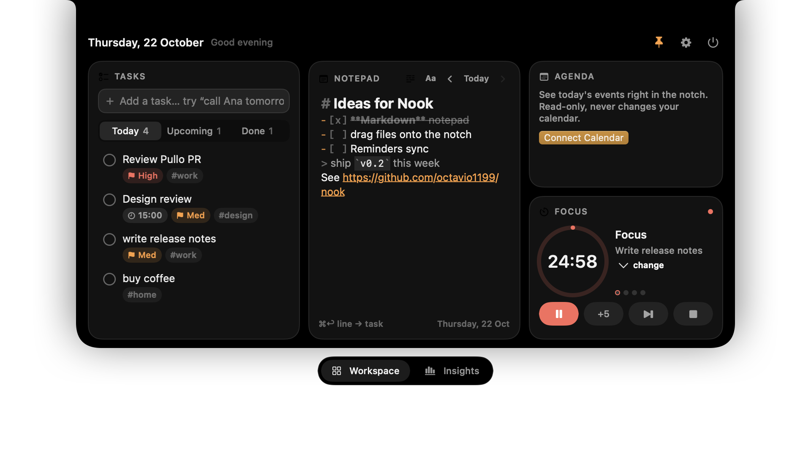
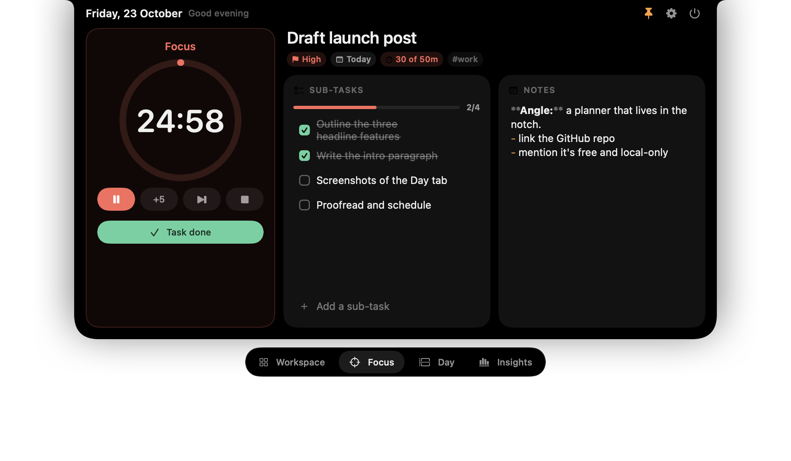
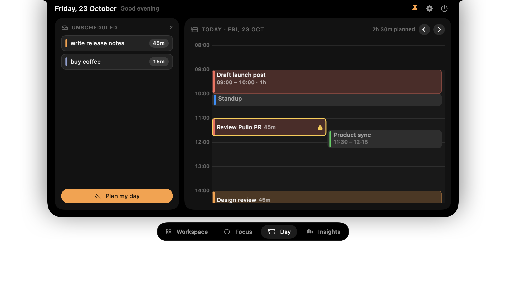
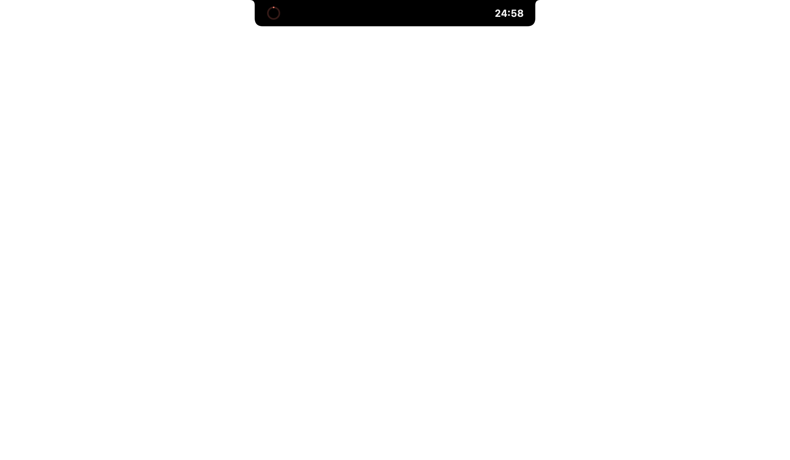
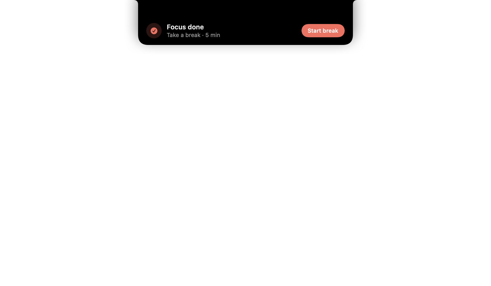

# Nook

A free, open-source **notch planner for macOS**. Hover the notch (or press ⌃⌥N) and get tasks, a daily notepad, a focus timer with sub-tasks, a time-blocked day and insights, without leaving what you are doing.

*Nook é um planner gratuito e open source que vive no notch do Mac: tarefas, bloco de notas diário, timer de foco com sub-tarefas, planejamento do dia em blocos e métricas. Sem conta, sem telemetria, dados em um JSON local.*

<p align="center"></p>

<p align="center">
  
  
</p>

<p align="center">
  
  
</p>

## Install

Requires macOS 14 or later (Apple silicon or Intel).

<p><a href="https://github.com/octavio1199/nook/releases/latest/download/Nook.dmg"></a></p>

**One line** (downloads the latest release into `/Applications` and opens it):

```bash
curl -fsSL https://raw.githubusercontent.com/octavio1199/nook/main/scripts/install.sh | bash
```

**Manually**

1. Download [`Nook.dmg`](https://github.com/octavio1199/nook/releases/latest/download/Nook.dmg) and open it.
2. Drag `Nook` to Applications.
3. Nook is ad-hoc signed, not notarized by Apple, so macOS blocks the first launch. Either run
   `xattr -dr com.apple.quarantine /Applications/Nook.app`, or open it once and go to
   **System Settings → Privacy & Security → Open Anyway**.
4. Hover the notch, or press **⌃⌥N** from any app (**⌥⌘N** opens a new task). On Macs without a notch, hover the top center of the screen.

To uninstall, quit Nook from its menu bar icon and delete `/Applications/Nook.app` (your data stays in `~/Library/Application Support/Nook/`).

### Português

1. Baixe o [`Nook.dmg`](https://github.com/octavio1199/nook/releases/latest/download/Nook.dmg), abra e arraste o `Nook` para Aplicativos.
2. Como o app não é notarizado pela Apple, libere a primeira abertura com
   `xattr -dr com.apple.quarantine /Applications/Nook.app` (ou em Ajustes → Privacidade e Segurança → Abrir Mesmo Assim).
3. Passe o mouse no notch ou use **⌃⌥N** (**⌥⌘N** cria uma tarefa nova).

Ou, em uma linha: `curl -fsSL https://raw.githubusercontent.com/octavio1199/nook/main/scripts/install.sh | bash`

## Features

- **Fast capture** with a local parser (no cloud AI): `call Ana tomorrow 3pm !high #work ~25m` becomes a task with date, time, priority, tag and estimate. Separate items with `;` or line breaks to brain-dump several at once.
- **New-task card** (⌥⌘N): title, notes, due date, priority, estimate, tags and "start focus now", all reachable with Tab and the arrow keys.
- **Tasks**: Today / Upcoming / Done / Archive, priorities, tags, estimates, sub-tasks, ⌘Z undo. Click a task for its details and its own Markdown notes.
- **Focus tab**: the task you're on, alone: timer, sub-tasks with progress, notes. Pomodoro presets (25/5, 50/10, 15/3), countdown, stopwatch. When time's up: +5 min, break then continue, or done.
- **Day tab**: time blocking on a 24-hour timeline with your calendar events. Drag tasks in, Plan my day, reminders before each block, push the rest of the day when you run late, and log untracked time on past days.
- **Markdown notepad**: daily autosaving notes with live Markdown (headings, bold, code, lists, clickable checkboxes, links), line wrap, list continuation. ⌘↩ on a line turns it into a task linked back to that day.
- **Live activity**: the notch grows wings with the timer and task during a focus, shows the current block, and warns before events.
- **Insights**: tasks done, focus minutes, streak, 7-day chart, time per task, planned vs actual.
- **Keyboard first**: rebindable global shortcuts (open, new task, pin, start a focus, move to this display) and ⌘1–⌘4 for the tabs.
- **Any display**: the notch, the main display, the one you're working on, or a specific monitor.
- Liquid Glass (macOS 26+) or solid panel. Universal binary, macOS 14+. See [CHANGELOG.md](CHANGELOG.md).

## Comparison

| | **Nook** | NotchOwl | Notchable |
|---|---|---|---|
| Price | Free | $9 one-time | $9.99 / $19.99 one-time (3-day trial) |
| Open source | Yes (MIT) | No | No |
| Universal (Apple silicon + Intel) | Yes | Apple silicon only | Yes |
| Quick capture / brain dump | Yes (local parser) | No | Yes (AI, cloud or on-device) |
| Live activity in notch | Yes | Timer pill only | Yes (v2.1) |
| Insights | Yes | Yes | Yes |
| Calendar agenda | Yes (read-only) | Yes (read-only) | Yes |
| Account / telemetry | None | License activation | License + analytics |

## Build from source

Requires macOS 14+ and Swift 6.2 (Command Line Tools are enough, no Xcode needed).

```bash
swift build          # debug build
scripts/test.sh      # run tests
scripts/bundle.sh    # build/Nook.app (universal, ad-hoc signed)
scripts/make-dmg.sh  # build/Nook.dmg with a drag-to-Applications window
scripts/run.sh       # bundle and open
open build/Nook.app --args --demo open   # sample data, nothing saved
```

Data lives in `~/Library/Application Support/Nook/planner.json`. Settings has Export JSON.

## Privacy

Nook makes no network requests. Calendar access is read-only and only requested when you press **Connect Calendar**.

## Contributing

Issues and pull requests are welcome. Keep `swift build` and `swift test` green. Note that with Command Line Tools only, SwiftUI's `@State` macro is unavailable; the code uses `@LocalState` / `@StateObject` instead.

## Credits and license

MIT, see [LICENSE](LICENSE). The notch shell (panel, hover and peek interaction, geometry) is adapted from **Pullo** by Gabriel Jordan (MIT); see [NOTICE](NOTICE).
